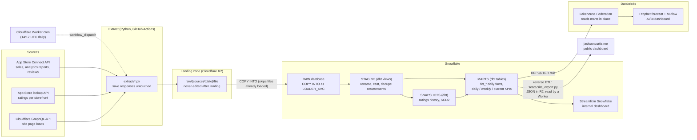

# DataStack

A deliberately over-engineered data pipeline for a tiny dataset. I wanted to understand
the "modern data stack" (Snowflake, dbt and Databricks) by building one end
to end, so I had [Claude Code](https://claude.com/claude-code) set it up with me on real data I care about:
download numbers for my iPhone app, **Chronic Health**, and traffic
to my personal website.

The whole warehouse fits in a few hundred rows. The goal is to replicate the process that a business
would go through, not the scale.

The end of the pipeline is public: a live dashboard on
[jacksoncurtis.me/projects/datastack](https://jacksoncurtis.me/projects/datastack), refreshed nightly.

## The raw data sources

| Source | What it is | How it's pulled | Grain |
|---|---|---|---|
| **App Store Connect: Sales reports** | Apple's daily SALES/SUMMARY report: first-time downloads, redownloads and updates, by country, device and version | `extract/asc_sales.py` calls the App Store Connect API (signed JWT) and saves Apple's gzipped TSV untouched | One file per day |
| **App Store Connect: Analytics Reports** | The App Store funnel: search impressions, product page views, downloads and app sessions, by source and referrer | `extract/asc_analytics.py` requests Apple's ongoing analytics reports and saves each report segment untouched | One file per report per processing day |
| **App Store ratings** | Star-rating count and average in every storefront | `extract/app_store_ratings.py` calls Apple's public lookup API for each country | One snapshot per day (no history from Apple, so it can't be backfilled) |
| **App Store reviews** | Written reviews (a rating plus title and text) | `extract/app_store_reviews.py` calls the App Store Connect API | One snapshot per day |
| **Cloudflare Web Analytics** | Page views and visits on my personal site, by page, referrer, country and device | `extract/cf_web_analytics.py` queries Cloudflare's GraphQL API and saves the JSON response (and the query that produced it) untouched | One file per day |

A few real-world wrinkles, small as the data is:
- **Apple publishes late, and a 404 is ambiguous.** "No report" can mean "no sales that
  day" or "not published yet." The extractor writes a `_NO_REPORT` marker only for days
  old enough to be settled, so the warehouse can tell **zero** from **unknown**.
- **Cloudflare downsamples with age.** Days older than about a week come back 1-in-10
  sampled, so the job pulls one day at a time, nightly, while it's still exact.
- **Sources restate.** Each nightly run re-pulls the last 5 days. Raw keeps every
  version, and staging keeps the latest. Apple's analytics reports repeat each day in
  later files too, so summing every file would double-count; staging keeps one version per day.
- **Some history only exists if you capture it.** Apple's ratings API only returns
  today's value, and Apple deletes analytics after about 35 days. A daily snapshot plus a
  dbt snapshot (SCD Type 2) turns "current value" into a history.

## How data flows



**E**xtract and **L**oad first, then **T**ransform inside the warehouse (ELT). Raw data
is never edited after it lands. Every business decision lives in version-controlled,
tested dbt models, so fixing a mistake means re-running dbt, not re-pulling from the source.

Every consumer reads the same marts, so the Streamlit app, the Databricks forecast and the
public page can't disagree about a number. Each automated stage runs as its own Snowflake
service user with one role (`LOADER_SVC` loads RAW, `TRANSFORMER_SVC` runs dbt,
`REVERSE_ETL_SVC` and `DATABRICKS_SVC` only read marts), and a resource monitor caps
monthly spend.

## The nightly run

A Cloudflare Worker cron (`scheduler/`) triggers `.github/workflows/extract.yml` each morning.
(GitHub's own `schedule:` trigger never fired for this repo, so an external cron starts it.)
The workflow:

1. Re-pulls the last 5 days from every source into R2.
2. Loads new files into Snowflake RAW.
3. Runs `dbt source freshness`, then `dbt build` (models, snapshot and tests) into the prod schemas.
4. If the build passes, exports the dashboard marts to JSON for the website (reverse ETL).

Databricks runs its forecast job about 40 minutes later, after the marts have refreshed.

## What's where

| Path | What it does |
|---|---|
| `extract/` | Python extractors, one per source. They write to R2, or to a local folder if `LANDING=./data`. |
| `warehouse/sql/` | Snowflake setup: roles, warehouses, a resource monitor (cost cap), the R2 stage, raw loads, service users and serving grants |
| `warehouse/sf.py` | Small runner for those SQL files (key-pair auth, `{{ENV_VAR}}` placeholders) |
| `dbt/` | Sources, staging and mart models, a ratings snapshot, a seed (Apple product-type codes), exposures and 50+ tests. Custom tests reconcile total downloads against the live counter on my site and check that two Apple sources agree. |
| `dashboards/` | The Streamlit in Snowflake app and its deploy script |
| `lakehouse/` | Databricks: Lakehouse Federation setup, the Prophet forecast notebook, its nightly job and an AI/BI dashboard, all deployed by `lakehouse/deploy.py` |
| `serve/` | Reverse ETL: exports the dashboard marts to one JSON file in R2 for jacksoncurtis.me |
| `scheduler/` | Cloudflare Worker that starts the nightly workflow |
| `.github/workflows/extract.yml` | The nightly job: extract, load, dbt build, export |

## Running it

Requires Python 3.12 and [uv](https://docs.astral.sh/uv/). Copy `.env.example` to `.env`
and fill in your own credentials.

```sh
uv run python -m extract.asc_sales 2026-11-01 2026-11-09     # land App Store sales
uv run python -m extract.asc_analytics                       # land the App Store funnel reports
uv run python -m extract.app_store_ratings                   # snapshot today's ratings
uv run python -m extract.app_store_reviews                   # snapshot today's reviews
uv run python -m extract.cf_web_analytics                    # land yesterday's site traffic
uv run python -m warehouse.sf -f warehouse/sql/02_raw_load.sql   # load Snowflake RAW
bin/dbt build                                                # staging + marts + tests (dev)
uv run python -m serve.site_export --out dashboard.json      # export the site JSON
uv run python -m dashboards.deploy_streamlit                 # deploy the Streamlit app
uv run python -m lakehouse.deploy --run                      # deploy + run the Databricks forecast
```

It's a learning project, not a template. Expect opinions in the comments.
