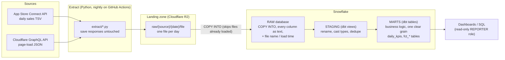

# DataStack

A deliberately over-engineered data pipeline for a tiny dataset. I wanted to understand
the "modern data stack" (Snowflake, dbt, and eventually Databricks) by building one end
to end, so I had [Claude Code](https://claude.com/claude-code) set it up with me for the
silliest data I own: download numbers for my iPhone app, **Chronic Health**, and traffic
to my personal website.

The whole warehouse fits in a few hundred rows. That's the point: the data is small
enough to reason about completely, so the interesting parts are the *patterns* (ELT,
raw vs staging vs marts, tests, freshness, cost controls), not the volume.

## The raw data sources

| Source | What it is | How it's pulled | Grain |
|---|---|---|---|
| **App Store Connect: Sales reports** | Apple's daily SALES/SUMMARY report: first-time downloads, redownloads and updates, by country, device and version | `extract/asc_sales.py` calls the App Store Connect API (signed JWT) and saves Apple's gzipped TSV untouched | One file per day |
| **Cloudflare Web Analytics** | Page views and visits on my personal site, by page, referrer, country and device | `extract/cf_web_analytics.py` queries Cloudflare's GraphQL API and saves the JSON response (and the query that produced it) untouched | One file per day |

A few real-world wrinkles, small as the data is:
- **Apple publishes late, and a 404 is ambiguous.** "No report" can mean "no sales that
  day" or "not published yet." The extractor writes a `_NO_REPORT` marker only for days
  old enough to be settled, so the warehouse can tell **zero** from **unknown**.
- **Cloudflare downsamples with age.** Days older than about a week come back 1-in-10
  sampled, so the job pulls one day at a time, nightly, while it's still exact.
- **Sources restate.** Each nightly run re-pulls the last 5 days. Raw keeps every
  version, and staging keeps the latest.

## How data flows



**E**xtract and **L**oad first, then **T**ransform inside the warehouse (ELT). Raw data
is never edited after it lands. Every business decision lives in version-controlled,
tested dbt models, so fixing a mistake means re-running dbt, not re-pulling from the source.

## What's where

| Path | What it does |
|---|---|
| `extract/` | Python extractors, one per source. They write to R2, or to a local folder if `LANDING=./data`. |
| `warehouse/sql/` | Snowflake setup: roles, warehouses, a resource monitor (cost cap), the R2 stage, and raw loads |
| `warehouse/sf.py` | Small runner for those SQL files (key-pair auth, `{{ENV_VAR}}` placeholders) |
| `dbt/` | Sources, staging and mart models, a seed (Apple product-type codes), and tests, including one that reconciles total downloads against the number my live site shows |
| `.github/workflows/extract.yml` | The nightly job: extract both sources, then load Snowflake RAW |

## Running it

Requires Python 3.12 and [uv](https://docs.astral.sh/uv/). Copy `.env.example` to `.env`
and fill in your own credentials.

```sh
uv run python -m extract.asc_sales 2026-11-01 2026-11-09     # land App Store sales
uv run python -m extract.cf_web_analytics                    # land yesterday's site traffic
uv run python -m warehouse.sf -f warehouse/sql/02_raw_load.sql   # load Snowflake RAW
bin/dbt build                                                # staging + marts + tests (dev)
```

It's a learning project, not a template. Expect opinions in the comments.
